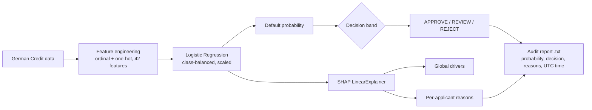

# Explainable Credit Risk Decision System

A credit-scoring app that does not stop at a probability. For each loan applicant it gives a decision (approve, manual review or reject), the SHAP reasons behind it, a fairness check across age, sex and nationality groups, and a timestamped audit report.

**Live demo:** [explainable-credit-risk-decision-system.streamlit.app](https://explainable-credit-risk-decision-system.streamlit.app/)

---

## Results

German Credit dataset (UCI, 1,000 applicants, 30 % defaults). Held-out 20 % test split (200 applicants, stratified, `random_state=42`). 20 raw attributes become 42 model features after encoding.

| Model | Accuracy | ROC-AUC | 5-fold CV ROC-AUC | Recall on defaults | Cost per applicant* |
|---|---|---|---|---|---|
| **Logistic Regression** (balanced) | **0.75** | **0.81** | 0.77 ± 0.02 | **0.78** (47 of 60) | **0.51** |
| Random Forest (300 trees, balanced) | 0.73 | 0.79 | 0.77 ± 0.03 | 0.58 (35 of 60) | 0.77 |
| Approve everyone (baseline) | 0.70 | — | — | 0.00 | 1.50 |

\*The dataset's own cost matrix: approving a borrower who defaults costs 5, rejecting a good borrower costs 1.

**Why the simpler model is the one in the app.** The Random Forest is not more accurate here, and it misses 25 of 60 defaulters against 13 for Logistic Regression. With a 5:1 cost of errors that makes it about 50 % more expensive per applicant. Logistic Regression is also the one an auditor can read directly.

**The decision bands hold up.** Default rate inside each band on the test set:

| Band | Probability | Applicants | Actually defaulted |
|---|---|---|---|
| APPROVE | < 0.30 | 78 | 10.3 % |
| MANUAL REVIEW | 0.30 – 0.60 | 52 | 23.1 % |
| REJECT | ≥ 0.60 | 70 | 57.1 % |

**Strongest risk drivers** (mean absolute SHAP value on the test set): no checking account, critical credit history, the "single male" status code, existing credits repaid on time, and the instalment rate.

---

## Fairness check

Measured before any mitigation, on the same 200 test applicants:

| Group | n | Rejected | Approved | Actual default rate |
|---|---|---|---|---|
| Under 25 | 39 | 48.7 % | 25.6 % | 48.7 % |
| 25 and older | 161 | 31.7 % | 42.2 % | 25.5 % |
| Female | 61 | 41.0 % | 29.5 % | 32.8 % |
| Male | 139 | 32.4 % | 43.2 % | 28.8 % |
| Foreign worker | 194 | 35.6 % | 37.6 % | 30.4 % |
| Not foreign worker | 6 | 16.7 % | 83.3 % | 16.7 % |

What this shows:
- For **age**, the higher reject rate for under-25s matches a higher real default rate in this data.
- For **sex**, women are rejected 8.6 points more often while their default rate is only 4 points higher, and a sex/marital-status code is one of the five strongest drivers. That gap is worth acting on (see next steps).
- **Foreign worker** cannot be judged from 6 applicants in the "no" group.

---

## How it works



- `src/features/` encodes ordered categories (employment length, savings) as ordinals and the rest as one-hot.
- `src/models/model_comparison.py` trains both models on the same split.
- `src/explainability/` builds SHAP global and per-applicant explanations.
- `src/ethics/bias_analysis.py` compares observed and predicted risk by group.
- `src/reports/` writes a timestamped decision report for each reviewed applicant to `reports/decision_reports/`.

---

## Run it

```bash
git clone https://github.com/dubeykrish0307/ECRDS.git
cd ECRDS
python -m venv venv && source venv/bin/activate    # Windows: venv\Scripts\activate
pip install -r requirements.txt
streamlit run app/main.py
```

Data: [Statlog (German Credit Data)](https://archive.ics.uci.edu/dataset/144/statlog+german+credit+data), UCI Machine Learning Repository. The raw files are included in `data/raw/`.

---

## Known limitations and next steps

- [ ] The demo app trains on all 1,000 rows and then scores applicants from those same rows, so the probabilities shown are in-sample. Score a held-out set in the app instead.
- [ ] Retrain without the sex/marital-status attribute and compare accuracy, cost and the reject-rate gap.
- [ ] Tune the decision bands against the 5:1 cost matrix instead of fixed 0.3 / 0.6 cut-offs.
- [ ] Remove the duplicated "Decision Justification" section in the app and stop committing `__pycache__/`.

---

**Krish Dubey**, B.Sc. Computer Science student at SRH Munich · [LinkedIn](https://www.linkedin.com/in/dubeykrish) · [GitHub](https://github.com/dubeykrish0307)
